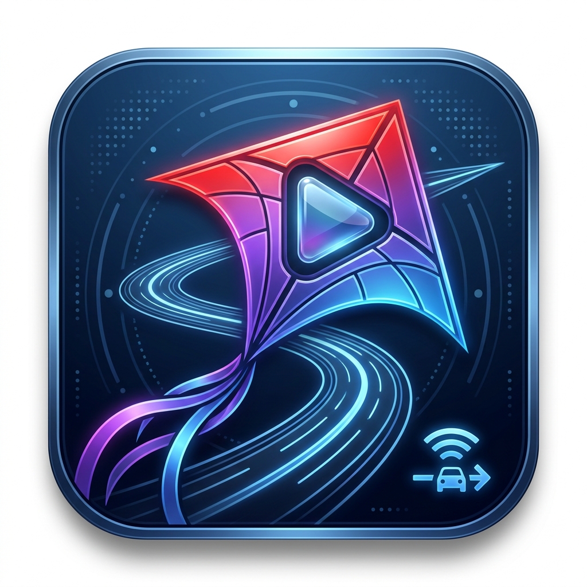

<p align="center"></p>

# KiteAuto

Lightweight web browser for the **Android Auto** screen, aimed at YouTube and other streaming sites.
Sideload only (it will not pass Play Store review).

## How it works
One Android Auto entry, backed by a browser that lives for the whole Android Auto session:

- **KiteAuto** (full screen): a legacy *projection* app (`CarActivity` from Google's unofficial Android Auto SDK,
  `aauto.aar`, the same approach as [Fermata](https://github.com/AndreyPavlenko/Fermata) Auto). A `WebView` renders on
  a private `VirtualDisplay` (zoomed density) into a full-screen `SurfaceView`; the car's real touch events are
  forwarded to it. Toolbar: **Back · Services · Search · Mic · Reload**, left edge, vertically centred (auto-hides). It
  opens only from the left-edge strip (swipe right or tap; a thin handle marks it), so taps on the page never
  pop it up. A platform
  `MediaSession` mirrors the page (title, play state) so media buttons reach it: play/pause/next/seek go to the
  page's `<video>` / YouTube's next button. No media-app entry in the Android Auto launcher. The dashboard media
  card shows the video's thumbnail (YouTube thumbnail or the page's Media Session artwork).
- **Knob**: tilting moves a cursor ring over the page (holding the tilt glides it, speeding up; the BMW sends only
  key-down/up, so KiteAuto repeats itself until key-up), pressing taps under it, rotating scrolls the page (the BMW
  delivers rotation as mouse-wheel `ACTION_SCROLL`/`AXIS_VSCROLL`), and tilting against the top/bottom edge scrolls
  too. The knob's touch surface sends nothing to the app in the BMW (the DHU's touchpad does, as `SOURCE_TOUCHPAD`,
  and moves the ring). Input events are logged (`adb logcat -s KiteAuto`).
  On YouTube pages KiteAuto injects a small stylesheet that scales the player's buttons (prev/play/next 1.7×,
  fullscreen 1.7×, settings/CC 1.4×) for finger use; it relies on YouTube's current class names.
- **Typing from the phone**: focusing a text field on the car page (e.g. YouTube search) opens a small window on the
  phone with the keyboard up (wakes the screen, shows over the lock screen and dismisses it: instant while Smart Lock
  keeps the phone unlocked); Go types into the car field and submits, its mic button dictates. Needs "Display over
  other apps" (button in the phone app); without it a notification with an inline reply field appears instead.
  Toolbar **Search** opens the site's own search box (same flow); toolbar **Mic** uses speech recognition.
- **Dropdowns** (`<select>`) on the car screen open an in-page list: Chromium's native select popup is a Dialog,
  which can't be added from the car's Presentation window and used to crash the app (seen on Jellyfin's
  audio/subtitle selects). It is *not* a navigation app, so Waze/Maps keep
  navigating, including the HUD/cluster guidance.

In the car (BMW X5 iDrive7, Android Auto 18) Android Auto shows KiteAuto in the large area with Waze's live map
(and turn-by-turn) in a card beside it, and Waze keeps the HUD guidance. The Desktop Head Unit only shows KiteAuto
full width, so check layout questions in the car. The app theme must have no action
bar: the car window inherits it, and an action bar paints an empty black bar over the top of the page.

Earlier attempts (removed): Car App Library *navigation* app (takes over navigation, HUD loses Waze guidance),
*POI* app with `MapWithContentTemplate` (mandatory side panel, small video), and a *media* app mirroring the page into
the dashboard media card (not needed once the car showed KiteAuto next to Waze's map).

## Build & install
Needs only Docker (with buildx) and adb. The APK is built by the `Dockerfile`; `aauto.aar` is fetched during the
build (`tools/fetch-aauto.sh`, SHA-256 pinned, not committed).
```sh
./build.sh          # → out/debug/app-debug.apk   (version = next release + "-dev")
./build.sh release  # → out/release/KiteAuto-<version>.apk
# Signing key: keystore/debug.keystore (created on first run, gitignored). Keep it: every build must be signed
# with it, or the phone refuses the update.
adb pair <ip>:<pair-port> <code>   # phone: Developer options → Wireless debugging → Pair with code
adb connect <ip>:<port>
./install.sh        # copies the APK to the phone's Download/ folder
```
Then install `Download/kiteauto.apk` on the phone with [KingInstaller](https://github.com/fcaronte/KingInstaller)
(classic method, all switches off). Do this for **every** update.

Why: Android Auto's validator only lists a sideloaded projection app if its install record says *initiated by
the package installer, installed by the Play Store*. AA's "Unknown sources" setting does not cover this app type, and
`adb install` (even `-i com.android.vending`) records the shell, so the app vanishes from AA. Samsung's installer
also ignores the Play Store flag when the install request comes from adb, so it has to start on the phone.
Background: [Fermata #846](https://github.com/AndreyPavlenko/Fermata/issues/846).
Check the record: `adb shell dumpsys package com.jimytar.kiteauto | grep -E 'installerPackageName|initiatingPackageName'`.

## Releases (CI)
`.github/workflows/release.yaml` runs on the self-hosted runner `kite-auto-runner` (ARC scale set, key `kite-auto` in
infrastructure `on-premises/simitli/02-k8s/03_GitHub_Runner.tf`). Every push to `main` that has new commits since
the last `vX.Y.Z` tag builds a signed release APK and publishes GitHub release `vX.Y.Z` with it. The version comes
from Conventional Commits (`scripts/next-version.sh`): `feat:` = minor, `type!:`/`BREAKING CHANGE` = major, else
patch; first release 1.0.0. Pull requests only build (APK as an artifact, unsigned).

Required repo secret `KITEAUTO_KEYSTORE_B64` = `base64 -w0 keystore/debug.keystore` (the same key as local builds,
so releases install over a local build and vice versa). Without it the workflow refuses to release.

To install a release: download `KiteAuto-<version>.apk` on the phone, install it with KingInstaller.

## Phone setup (once)
1. Install with KingInstaller (above).
2. Android Auto → **Customize launcher** → enable KiteAuto.
3. Open KiteAuto on the phone, edit the services list, tap **Open** on YouTube to sign in (cookies are shared with the car).

**Car page zoom** (phone app, default 73%) scales pages on the car screen like browser zoom. 73% puts the BMW's
1292 px wide screen at ~1290 CSS px, just past m.youtube's 1280 px wide-layout breakpoint. Changes apply the next
time KiteAuto opens on the car screen.

In the car, typed text that is not a URL becomes a YouTube search. AA hides the keyboard while driving; edit the list
on the phone instead.

## Testing without a car (Desktop Head Unit)
Runs Google's DHU (Linux build) in WSL; the window appears on the Windows desktop via WSLg.
1. Once: download `desktop-head-unit-linux-x64` (SDK package `extras;google;auto`) into `~/.local/share/android-dhu`
   and `sudo apt install libc++1 libc++abi1`.
2. Phone: Android Auto settings → ⋮ → **Start head unit server**.
3. `./tools/dhu.sh` (profile `tools/dhu-bmw.ini` approximates the BMW widescreen: KiteAuto gets ~1330×540 @ 220 dpi,
   the car gives 1292×499 @ 220 dpi). Android Auto lists newly installed projection apps only on (re)connect:
   restart the DHU after the first install.

The DHU skips Android Auto's install-source check, so for UI iteration a plain
`adb install -r out/debug/app-debug.apk` is enough. Before using it in the car again, reinstall
with `./install.sh` + KingInstaller. Type `screenshot <file.png>` or `tap <x> <y>` into the DHU console to script it.
Logs: `adb logcat -s KiteAuto chromium`.
